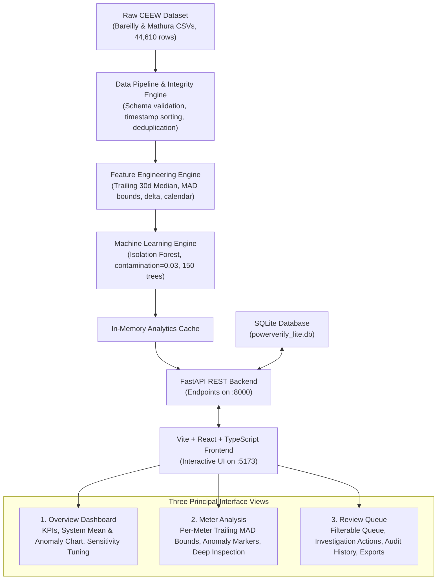
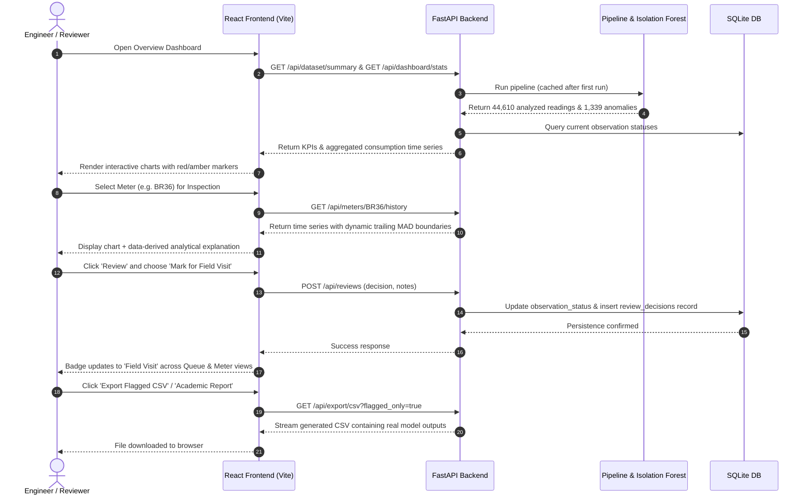

# PowerVerify: System Architecture & Workflow

PowerVerify is an academic-grade smart-meter electricity consumption anomaly detection and verification system built from scratch for the **AI Blend for Engineers** academic evaluation.

---

## 1. High-Level Architecture Diagram

---

## 2. End-to-End Operational Workflow

---

## 3. Machine Learning Methodology Rationale

### Why Isolation Forest?
1. **Unsupervised Formulation:** The CEEW smart-meter dataset contains real, unlabelled household meter consumption. No confirmed fraud or tampering labels exist. Supervised algorithms (e.g. Random Forest classifier, XGBoost) would require fabricating ground truth labels or relying on synthetic tampering assumptions. Isolation Forest makes zero fraud assumptions and identifies behavioural outliers strictly through data isolation depth.
2. **Sub-sampling & Efficiency:** By isolating points through random axis-aligned splits, anomalies (which have extreme consumption or abnormal ratios) are separated near the root of the tree with short average path lengths:
   $$s(x, n) = 2^{-\frac{E(h(x))}{c(n)}}$$
   Where $E(h(x))$ is the average path length across 150 isolation trees, and $c(n)$ is the average path length of unsuccessful searches in a Binary Search Tree.
3. **Multi-Feature Context:** Rather than looking only at absolute kWh, the model evaluates multidimensional dynamics:
   - Consumption magnitude (`kwh`)
   - Day-over-day volatility (`kwh_change`)
   - Trailing baseline ratio (`baseline_ratio`)
   - Robust standardized deviation (`robust_z`)
   - Weekly cycle (`day_of_week`)

---

## 4. Historical Expected Threshold Methodology (Robust MAD)

Standard deviation is heavily distorted by the very anomalies we wish to detect (a single 80 kWh spike inflates the sample standard deviation). PowerVerify Lite instead implements **Median Absolute Deviation (MAD)**:

$$\text{MAD} = \text{Median}(\|x_i - \text{Median}(X)\|)$$

To match the standard normal scale, the consistent scale estimator is:
$$\hat{\sigma}_{\text{robust}} = 1.4826 \times \text{MAD}$$

The expected consumption band is defined as:
$$\text{Upper Bound} = \text{Median} + 2.5 \times \hat{\sigma}_{\text{robust}}$$
$$\text{Lower Bound} = \max\left(0.0, \text{Median} - 2.5 \times \hat{\sigma}_{\text{robust}}\right)$$

### Prevention of Data Leakage
All medians and MAD values are computed over a **trailing 30-day window** preceding and including the day of observation. Future readings never influence past baselines.

---

## 5. Three Standard Investigation Decisions

To provide an intuitive, human-in-the-loop workflow without pseudo-fraud jargon:

1. **Acknowledge / No Further Action:** Observation has been reviewed and determined to be benign or explainable without dispatching personnel.
2. **Mark for Field Visit:** Observation exhibits severe drop, erratic zero-consumption, or unpermitted surge warranting physical inspection of the meter box, seal integrity, and wiring.
3. **High Usage Authorized:** Observation reflects verified permitted demand (e.g. household wedding, construction equipment, or approved seasonal load).

---

## 6. Critical Ethical & Academic Boundary

- **Anomalies $\neq$ Proven Theft:** Statistical outliers indicate unusual consumption, NOT confirmed electricity theft.
- Low-usage anomalies frequently stem from household vacancies, supply outages, or CT/PT telemetry failure.
- High-usage anomalies frequently stem from festive events, air conditioning during summer heat waves, or additional household occupants.
- Human-in-the-loop verification is mandatory before taking punitive or administrative action.
